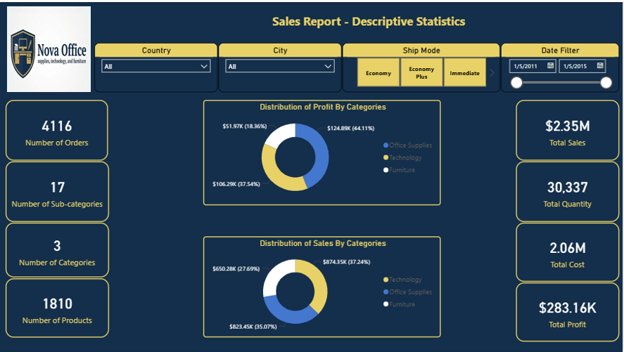
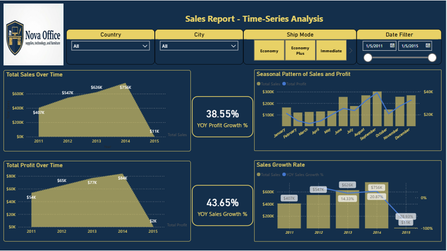
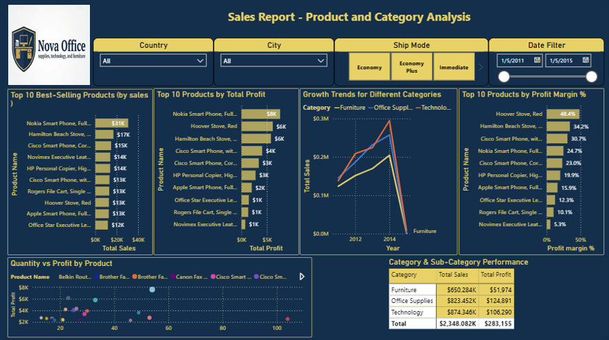
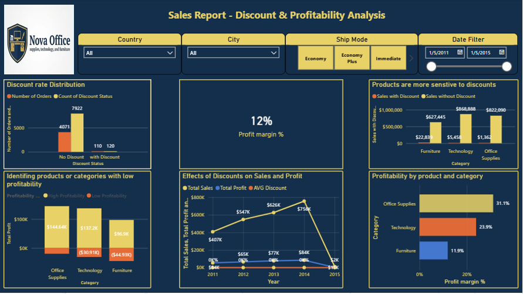
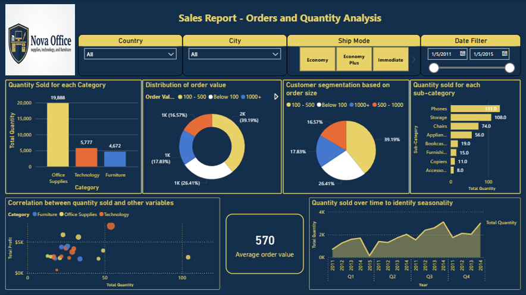
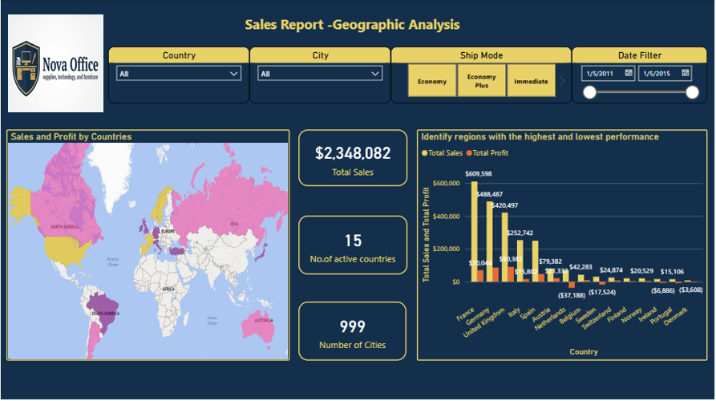
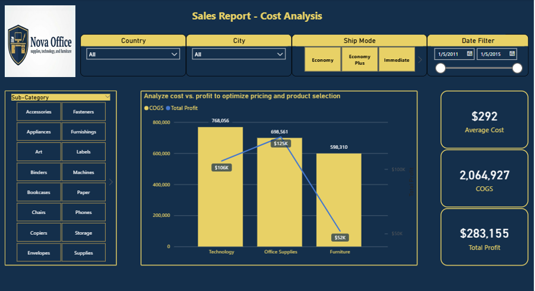
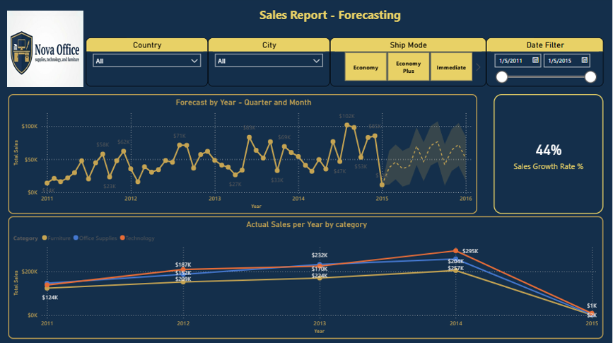

# 📊 Sales Performance Analysis Report | Power BI

An end-to-end sales analytics project using Power BI to analyze sales performance, profitability, product trends, discounts, geographic performance, costs, and sales forecasting. The project transforms sales data into an interactive **8-page dashboard** to support data-driven business decisions.

## 📌 Project Overview

This project explores sales performance and profitability across products, categories, and markets. It analyzes **4,116 orders, 1,810 products, 17 sub-categories, and 3 product categories** to answer key business questions:

- How much revenue and profit does the business generate?
- Which products and categories contribute most to sales and profitability?
- How do discounts relate to sales and profit?
- Which countries and cities perform best or generate losses?
- How do costs vary across product categories?
- What do historical sales trends suggest about future performance?
🎯 Objectives

Build an interactive Power BI report for business users.

Track key performance indicators (KPIs), including sales, profit, quantity, cost, and average order value.

Compare performance across categories, sub-categories, and products.

Analyze sales trends and seasonality over time.

Investigate discount patterns and profitability.

Explore geographic performance and cost structure.

Use sales forecasting visuals to examine potential future trends.


## 📂 Repository Structure

```text
Sales_Performance_Analysis_PowerBi/
├── Sohair Samer Yehia PowerBi Project.pbix
├── Power BI - Sales Project Data - Un-cleaned.xlsx
├── images/
│   ├── 01-descriptive-statistics.PNG
│   ├── 02-time-series-analysis.PNG
│   ├── 03-product-category-analysis.PNG
│   ├── 04-discount-profitability.PNG
│   ├── 05-orders-quantity.PNG
│   ├── 06-geographic-analysis.PNG
│   ├── 07-cost-analysis.PNG
│   └── 08-forecasting.PNG
└── README.md
```


## 📑 Report Pages

The report includes eight pages, each focusing on a different aspect of business performance.

| # | Report Page | Analysis |
|---|---|---|
| 1 | Descriptive Statistics | Orders, products, categories, sales, quantity, cost, profit, and category contributions |
| 2 | Time-Series Analysis | Sales and profit trends, monthly seasonality, and yearly sales growth |
| 3 | Product & Category Analysis | Top products by sales and profit, category trends, and product-level comparisons |
| 4 | Discount & Profitability Analysis | Discount distribution, sales and profit patterns, and category profitability |
| 5 | Orders & Quantity Analysis | Quantity by category and sub-category, order value distribution, and order-size analysis |
| 6 | Geographic Analysis | Sales and profit by country, including stronger and weaker markets |
| 7 | Cost Analysis | Cost of goods sold (COGS) compared with profit, with category and sub-category analysis |
| 8 | Forecasting | Sales forecast by month and quarter, alongside actual sales by category |

🔍 Key Findings

Overall performance: 4,116 orders generated approximately $2.35M in sales and $283K in profit, with an overall profit margin of about 12%.

Furniture is the weakest category: It generated approximately $52K in profit on $650K in sales, equivalent to an estimated 8% profit margin.

Office Supplies: Generated approximately $125K in profit on $823K in sales, equivalent to an estimated 15% profit margin. It contributed the largest share of total profit among the three categories.

Technology leads in sales: It generated approximately $874K in sales, representing about 37% of total sales, while Office Supplies contributed the largest share of profit.

Sales trends: Sales increased from approximately $407K in 2011 to $756K in 2014, an increase of about 86%. The report also explores monthly seasonality.

Sales volume: Office Supplies accounted for the largest reported quantity sold, at approximately 19,888 units.

Geographic performance: The report compares sales and profitability across countries to identify strong markets and locations with negative profit.

Cost structure: Total reported cost was approximately $2.06M, with Technology carrying the highest cost and Furniture the lowest among the three categories.

Note: Figures are rounded. The 2015 period appears to contain substantially less sales data than earlier years, so comparisons and forecasts involving that period should be interpreted cautiously. Verify final figures against the Power BI report before publication.


## 🗃️ Dataset

The source Excel workbook contains multiple related tables used for sales analysis and data modeling.

| Table | Purpose |
|---|---|
| Order Details | Sales, profit, quantity, discount, and product/category keys |
| Orders | Order information, customer and geographic keys, shipping mode, and dates |
| Product | Product information and product keys |
| Customer | Customer information and customer keys |
| Category | Product category lookup |
| Sub-Category | Product sub-category lookup |
| Country | Country lookup |
| City | City lookup |
| Ship Mode | Shipping mode lookup |

These tables support the analysis by connecting sales transactions with product, customer, category, and geographic information.


🛠️ Tech Stack

Power BI Desktop: Data modeling, interactive visualizations, slicers, and forecasting.

DAX: KPI calculations, profitability metrics, and growth measures.

Microsoft Excel: Source data and supporting tables.

🚀 How to Use

Download or clone this repository.

Open Sohair Samer Yehia PowerBi Project.pbix using Power BI Desktop.

If prompted, verify or update the source data path.

Refresh the data if required.

Explore the report pages and use the available filters to investigate sales and profitability.

⚠️ Limitations & Next Steps

Potentially incomplete 2015 data: Reported sales for 2015 are much lower than in previous years. The underlying date coverage should be checked before drawing conclusions about annual growth or forecasts.

Discount analysis: Conclusions about discount effects should be interpreted in light of the number and distribution of discounted transactions.

Forecast uncertainty: Forecasts are estimates based on historical patterns and should not be treated as guaranteed future results.

Potential extensions:

Customer segmentation using RFM analysis.

Deeper analysis of profit drivers at the sub-category level.

What-if analysis to evaluate alternative discount strategies.

Additional validation of data quality and time coverage.

🖼️ Dashboard Screenshots

1. Descriptive Statistics





2. Time-Series Analysis




3. Product & Category Analysis




4. Discount & Profitability Analysis




5. Orders & Quantity Analysis




6. Geographic Analysis




7. Cost Analysis



8. Forecasting



## 👩‍💻 Author

**Sohair Samer Yehia** — Data Analyst

- [LinkedIn](https://www.linkedin.com/in/sohair-samer)
- [GitHub](https://github.com/Sohairsamer11)

